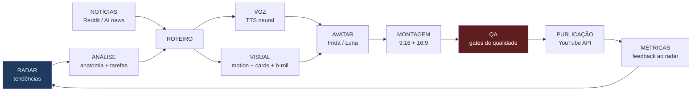

# CONTRATO DO PROJETO — Fábrica de Canais (ArtCraft)

> Documento de referência. Qualquer modelo/agente que entre no projeto deve ler **só este
> ficheiro** para saber o que estamos a construir, o que já existe e o que falta.
> Última actualização: 2026-11-15.

---

> **LLM local DESACTIVADA.** Ollama não funciona nesta máquina (quebrado/instalado mas sem
> modelos). A geração de guiões e qualquer inferência local de texto usa **OpenRouter com
> modelos FREE** — ver §13. Nunca usar Ollama. Nunca usar modelos PAGOS.

---

## 1. Visão em uma frase

Uma **fábrica automatizada de canais de YouTube**: descobre o que está a bombar, clona o
**formato** (não o conteúdo) de 1–3 canais, personaliza com a nossa identidade (avatares
Frida e Luna, paleta, tipografia, motion), escreve e produz o vídeo em **pt-BR, en-US e
es-ES**, e publica — todos os dias, sem intervenção manual.

O avatar é **1 % do projeto**. É uma peça do motor, não o produto.

---

## 1.1 Ordem obrigatória de trabalho (não negociável)

Antes de produzir qualquer vídeo, **a análise vem primeiro**. A ordem é fixa:

```
1. ANALISAR a referência  →  2. IDENTIFICAR tudo o que é preciso  →
3. CRIAR uma tarefa por passo  →  4. VALIDAR (medido, não estimado)  →
5. SÓ ENTÃO executar as tarefas até a clonagem estar pronta
```

Regras que daí derivam:

| Regra | Consequência prática |
| --- | --- |
| Nada se produz antes de a análise fechar | se `analysis/plan.json` ou `TASKS.md` não existirem, o build não deve arrancar |
| Tudo o que se afirma vem de medição | cada número do plano cita o passo que o mediu (anatomia, S3FD, OCR) |
| Cada passo em falta é uma tarefa com estado | `todo` / `done` / `blocked` / `optional` — nunca "acho que está feito" |
| Validar antes de executar | plano sem cenas, sem texto lido ou sem apresentador atribuído é erro, não aviso |
| O fim é o clone pronto | o trabalho só fecha quando houver MP4 renderizado e verificado |

O passo que executa isto é o **analisador de referência** (`§3.3`). É ele que abre o
trabalho; o `yt-clone-build.mjs` só entra depois.

---

## 2. Fluxo da fábrica (visão completa)



### 2.1 As três entradas de sinal
| Sinal | Fonte | Para que serve |
|-------|-------|----------------|
| **Tendência** | YouTube (views, cadência, shorts) | decidir *que formato* clonar |
| **Notícia** | Reddit, portais, feeds de IA | decidir *sobre o que falar agora* |
| **Nosso catálogo** | clones anteriores + métricas | decidir *o que repetir* |

### 2.2 O princípio central: clonar estrutura, misturar temas
Não se copia o vídeo. Copia-se a **anatomia** e aplica-se a um tema nosso — e, sempre que
possível, **misturam-se 2–3 canais/temas** para produzir um terceiro canal original nosso.

```
canal A (formato de cortes rápidos)  ┐
canal B (formato de análise longa)   ├──►  canal NOSSO (formato híbrido + Frida/Luna)
tema C (notícia do dia)              ┘
```

Isto resolve dois problemas de uma vez: não é cópia descarada (política de conteúdo
reutilizado do YouTube) e cria identidade própria.

---

## 3. Módulos do sistema

| # | Módulo | Estado | Ficheiro / como se corre |
|---|--------|--------|--------------------------|
| M1 | **Radar de tendências** | ✅ feito | `.artcraft/yt-channels.mjs`, `yt-top-world.mjs` |
| M2 | **Análise de canal/formato** | ✅ feito | `.artcraft/yt-format-profile.mjs` |
| M2b | **Anatomia da referência → plano + tarefas** | ✅ feito | `.artcraft/yt-ref-analyze.mjs` (`§3.3`) |
| M3 | **Mesclagem de canais** | ❌ não começou | — |
| M4 | **Watcher de notícias** | ❌ não começou | — |
| M5 | **Roteiro** | ✅ gera via OpenRouter FREE | `.artcraft/yt-script.mjs` (verificado 2026-11-15); integrado no §3.3.1 |
| M6 | **Voz (TTS)** | ✅ resolveu | VoiceCraft :8090 (10 provedores) |
| M7 | **Avatar/apresentador** | ✅ funciona | LivePortrait + Frida/Luna |
| M8 | **Motion / composição** | ✅ kit pronto | `work/clone-tooling/explainer-effects.mjs` — 9 comps verificadas (`§3.4`) |
| M9 | **Montagem/export** | ✅ feito | ffmpeg + SoundCraft master |
| M10 | **Publicação** | ❌ stub | `uploadToYouTube()` sem OAuth |
| M11 | **QA / gates** | ❌ não começou | — |
| M12 | **Painel de controlo** | ✅ feito | `yt-dashboard.mjs` + `yt-daemon.mjs` |

---

## 3.1 Voz: VoiceCraft (:8090) — estado real

Servidor local em `D:\CRAFT\VoiceCraft`, 10 provedores com cascata. **Tudo parametrizável**
em `clone.config.json → voice.voicecraft` e em `avatar.avatars.<nome>.voice.<idioma>`.

| Provedor | Estado | Precisa chave? |
|---|---|---|
| **nvidia** (Magpie) | ✅ 2 chaves, pt/en/es | sim (grátis em build.nvidia.com) |
| **gemini** (2.5 TTS) | ✅ 7 chaves, emoção por prompt | sim (grátis AI Studio) |
| **edge** (Azure Neural) | ✅ sem chave, ilimitado | **não** |
| **gcloud** (Chirp 3 HD) | ✅ 7 chaves | sim (exige cartão) |
| elevenlabs · openai · polly | ⚪ sem chave local | sim — **mas** ver Puter.js |
| azure · voicestudio · kokoro | ⚪ sem chave / offline | sim / subir serviço |

**Puter.js** (no painel do navegador, `http://127.0.0.1:8090`): liberta ElevenLabs, OpenAI e
Polly **sem chave local**, via conta Puter. É JavaScript no cliente — **não** existe endpoint
HTTP, por isso o pipeline não o usa; serve para o humano escolher a voz.

Comando de estado ao vivo: `node D:\CRAFT\.artcraft\voicecraft-status.mjs`

---

## 3.2 OpenMontage: 98 skills utilizáveis

`D:\CRAFT\OpenMontage\.agents\skills\` — cada uma tem `SKILL.md` com comandos prontos.
As que interessam à fábrica:

| Skill | Para quê |
|---|---|
| **video-understand** | ver um vídeo (frames + Whisper) — **já usado** |
| **video-download** | sacar a referência |
| **video-edit** · **ffmpeg** | cortes e montagem |
| **video-translate** | multi-idioma |
| **motion-graphics** · **remotion** | motion a sério |
| **visual-style** | identidade visual |
| **sound-effects** · **music** | áudio |
| **avatar-video** · **faceswap** · **heygen** | apresentadores |
| **comfyui** | geração local (o nosso `D:\Comfy`) |
| **manim-composer** · **d3-viz** | gráficos e explicações |
| **website-to-video** | site → vídeo |

---

## 3.3 Analisador de referência — o passo que abre o trabalho

```sh
# a partir de URL (descarrega sozinho) ou de um ficheiro já medido
node .artcraft\yt-ref-analyze.mjs --url "https://youtube.com/shorts/XXXX"
node .artcraft\yt-ref-analyze.mjs --video ref1080.mp4 --slug ref5-clone --scenes 6
#   opções: --accent #FF6A00  --presenters frida,luna  --no-ocr  --no-faces
#           --workers 4  --script (narração original via yt-script.mjs, modelos FREE)
```

**E o `yt-clone-build.mjs` agora corre a análise por omissão** (2026-11-15):
`--url <youtube-url>` ou `--video <ficheiro>` fazem o build executar este analisador no
passo **0-A/6 referencia** antes de qualquer fase, e o `script.json` produzido (cenas
medidas: `layout`, `splitRatio`, `textSide`, `start`, `seconds`, `avatar`, `narration`)
substitui as cenas do `clone.config.json`. Sem `--url`/`--video`, o comportamento é
inalterado (usa as cenas do config). O daemon passa `--url` automaticamente quando o
dashboard clona com um URL de referência.

**Sem este passo, o clone de 2026-11-15 ("yryryr") saiu 100% desligado da origem:** o
dashboard mandou `url`/`sourceVideoId`, mas o motor nunca lia `params.url` — a narrativa
saiu do config (genérica sobre avatares), o aspecto visual idem, e `target.url` ficou
`""`. Nada de errado com o render: só faltava este passo. Detalhe do desastre em §3.3.1.

Escreve três ficheiros em `work/clones/<slug>/`:

| Ficheiro | Conteúdo |
| --- | --- |
| `analysis/plan.json` | anatomia medida + as cenas do clone (layout, split, frase, acento) + lista de tarefas com estado |
| `TASKS.md` | tabela legível: métricas medidas e uma linha por tarefa |
| `script.json` | guião pronto para o `yt-clone-build.mjs` |

O que mede, e **como** (nada é estimado):

| Medida | Ferramenta | Nota |
| --- | --- | --- |
| Cortes, duração de plano, geometria, texto vs fundo, paleta | `.artcraft/yt-ref-anatomy.mjs` | zero dependências, descodifica rgb24 |
| Presença e caixa da cara (quem está em cena, a que altura) | `tools/ref-face-detect.py` | S3FD que já vem com o Wav2Lip — **sem instalar nada** |
| Texto na tela, linha a linha, com coordenadas | `tools/win-ocr.ps1` | Windows.Media.Ocr nativo — **sem instalar nada** |
| Palavra em laranja (acento) | o próprio analisador | amostra os pixels reais da caixa de cada palavra e compara a matiz com `--accent` |
| Tipo de plano (card / whiteboard / talking-head / ui / graphic) | `kindOf()` | regra única a partir de papel, escuro, cara e nº de linhas |

Detalhes de implementação que já custaram tempo e não devem ser revertidos:

- **OCR em lote.** Extrair 33 frames e chamar o PowerShell uma vez (`-Dir`) leva ~10 s;
  um processo por frame levava ~20 s × 33 e estourava qualquer timeout.
- **OCR do Windows só tem um motor instalado** (o do perfil do utilizador, `pt-BR`). `-Lang en`
  falha e cai para esse motor; a qualidade em 1080p é suficiente na mesma.
- **Detector de cara**: usa `detThresh 0.10` porque os avatares/personagens estilizados não
  são caras humanas para o S3FD.
- **Frase da cena** = a linha mais longa sem interferências (`growsembly`, `script.md`), em
  maiúsculas. É a manchete, não o rodapé.
- **Todos os `run()` devolvem `{code, out, err}`, nunca `.stderr`** (2026-11-15). Dois
  pontos chamavam `(r.stderr || …)` com resultado `undefined` → `TypeError: … reading
  'slice'` no meio do pipeline, escondido atrás de uma mensagem genérica.

### 3.3.1 O clone saía desligado da origem — causa raiz medida e corrigida

**Incidente "yryryr" (2026-11-15).** O dashboard enviou um clone com
`{"prompt":"yryryr","sourceVideoId":"UTubvRLX2j4","url":"https://www.youtube.com/shorts/UTubvRLX2j4"}`.
O `manifest.json` resultante prova a causa: `target.url = ""`,
`script.source = "clone.config.json"` — ou seja, **o vídeo `yt-clone-build.mjs` nunca lia a
referência**: a narrativa saiu das 4 cenas genéricas do config (sobre avatares de IA), a
voz idem, o texto e as imagens idem. Não foi falha do render nem do avatar — foi ausência
de qualquer passo de análise.

**Fix (agora integrado):** `yt-clone-build.mjs` aceita `--url`/`--video` e, na fase
`0-A/6 referencia`, chama `yt-ref-analyze.mjs` para produzir `script.json` (cenas
medidas). O daemon (`buildCloneArgs`) passa `--url` automaticamente quando o dashboard
clona com um URL do YouTube.

**Teste medido (referência Guney Topcu / AI Made Easy — whiteboard explainer):**
`node .artcraft/yt-ref-analyze.mjs --video work/...f788.mp4 --slug verify-ref --scenes 6`
→ `analysis/plan.json` (33 planos, 31.9 cortes/min, plano médio 1.82s, layoutMix
`{full: 2, split: 4}`, splitLineMedian 0.58, faceRatio 0.69, 125/181 amostras com cara
125/181, OCR 217 linhas em 33/33 planos) e `script.json` com as 6 cenas medidas.

**Bloqueio do download (honesto):** a referência por URL devolve **HTTP 403 Forbidden**
desta máquina (YouTube bloqueia este IP / sem JS runtime). O caminho local funciona —
quem quiser um clone por URL precisa baixar o vídeo via browser para a máquina e usar
`--video <ficheiro>`, ou reconfigurar o canal de download.

**Narração.** Sem `--script`, a narração vem da frase medida na tela (OCR). Para texto
original com o mesmo formato (estrutura, não cópia), usar `--script --topic "tema"`:
`yt-script.mjs` escreve via **OpenRouter FREE** — testado: `cohere/north-mini-code:free`
respondeu em 19,7 s, 6 cenas, 170 palavras, JSON válido.


---

## 3.4 Kit de efeitos do explainer — porque é que os clones falharam

Esta secção existe para que ninguém repita o erro. O diagnóstico fechou em 2026-11-13.

### O que estava errado (medido, não estimado)

**`ref5-clone`** — a análise estava certa (33 planos, 16 split, splitline 57 %, laranja
`#FF6A00`), o build é que nunca escreveu uma camada de texto. Prova em
`work/clones/ref5-clone/build/motion-pt_BR.jsonl`: 1 `file.newProject` + 6 `comp.new`,
**zero** `layer.newText`. Composições com fundo e mais nada — daí a banda superior vazia e
a tela inicial branca.

Causa raiz, no `yt-clone-build.mjs`, dentro de `buildMotionCards()`:

```js
if (captionMode) continue;   // textStyle.mode === "caption" → salta TODAS as camadas
```

`cards.textStyle.mode: "caption"` **junto com** `cards.motion.enabled: true` produz comps
vazias. `"caption"` só faz sentido quando a frase é queimada depois, na camada ASS; com
motion ligado o modo tem de ser `"layers"`.

**`edl-ref5`** — falhou por acumulação: 28 cenas a fatiar uma narrativa de 60 s, todas com o
mesmo cartão bege `#F0E6D8`, `cards.motion.enabled: false`, `transition: none` e voz SAPI.
Estrutura certa, repetição visual e voz robótica = resultado "lixo".

### O kit (9 composições, verificadas a renderizar)

`work/clone-tooling/explainer-effects.mjs` emite 293 comandos e produz `.ecproj`, um PNG de
QA e um MP4 por composição:

| comp | tamanho | efeito que reproduz |
| --- | --- | --- |
| `E1_whiteboard` | 1080×1920 | quadro branco: line-art a traço, caneta, `A VIDEO EDITOR` com o `A` laranja |
| `E2_caption_top` | 1080×1920 | legenda cinética no topo |
| `E3_caption_bottom` | 1080×1920 | legenda no rodapé, já por cima do apresentador |
| `E4_neon_grid` | 1080×1250 | grelha 3×2 de cartões com contorno néon + asterisco |
| `E5_ui_panel` | 1080×1250 | painel de app com moldura luminosa e barra de prompt |
| `E6_split_band` | 1080×1094 | banda superior do corte split |
| `E7_panel_stack` | 1080×1250 | três painéis sobrepostos (o "vários vídeos acima") |
| `E8_full_graphic` | 1080×1920 | gráfico a sangrar no quadro inteiro ("a tela fica maior") |
| `E9_presenter_zone` | 1080×826 | metade inferior do split, onde entra o avatar |

`E6` (1094) + `E9` (826) = **1920 exactos** — empilham sem reescalar.

### As quatro regras que fazem a diferença

1. **`strokeOverFill: false` é obrigatório no texto.** Com `applyStroke` e 10 px de contorno
   numa haste de ~12 px, o traço pinta **por cima** do preenchimento e a letra fica toda
   preta. Era isto que dava o ar de "bloco preto" nas legendas.
2. **A palavra-herói laranja é sempre a primeira da linha.** Desenha-se a linha a branco e
   cobre-se o início com a *mesma* layer em laranja, mesma caixa, mesmo `justify: left`.
   Alinhamento exacto sem métricas de fonte — o EffectCraft não tem comando de medida.
3. **Encolher até caber.** O tamanho desce 4 % de cada vez até a largura estimada caber em
   `1080 − 2×62 px`. Sem isto as legendas sangram pelas bordas.
4. **Néon = três traços sobrepostos** (16 px a 22 %, 10 px a 34 %, 5 px a 46 %) mais um
   núcleo de 3 px opaco. É o que dá o brilho dos cartões.

### O que ainda falta para fechar o objectivo

- Ligar as 9 peças ao `yt-clone-build.mjs` (hoje o kit é uma biblioteca à parte).
- Compositing do apresentador: `E6` por cima do footage, avatar em baixo, `E9` como guia de
  enquadramento — o LivePortrait **não** é áudio-driven, os lábios só batem com o Wav2Lip.
- Reveal progressivo do traço no `E1` (`proj.addKey` + `keys.interpolation`), hoje o
  line-art aparece completo desde o primeiro frame.

Armadilhas de CLI (ids que existem, cores, caixas de texto, ordem `run` → `render`) estão em
`AGENTS.md`, secção "Explainer effects kit".

---

## 4. Identidade visual própria (a definir contigo)

Tudo abaixo é configurável em `clone.config.json`; os valores são **proposta**, não decisão
fechada.

| Elemento | Onde | Actual (proposta) |
|----------|------|-------------------|
| Paleta | `cards.palette` | fundo `#0b0b12`, texto `#f4f4f4`, destaque `#e04848`, muted `#9aa3b5` |
| Tipografia | `cards.fontFamily` | Inter Bold |
| Kicker / headline / body | `cards.avatarKicker/Headline/Body` | 30 / 76 / 40 px (base 1080) |
| Apresentadores | `avatar.avatars` | **Frida** (bulldog, apresentadora), **Luna** (dachshund, comentarista) |
| Motion | `motion.kenBurns` | zoom 1.0 → 1.07 |
| Transições | `transition` | xfade 0.35 s |
| Áudio | `loudness` | −14 LUFS, TP −1.5 |

**Pendente:** definir a paleta definitiva e o grafismo (marca, rodapé, lower third).

### 4.1 Duas apresentadoras, papéis fixos

| Apresentadora | Espécie | Papel | Voz por idioma |
| --- | --- | --- | --- |
| **Frida** | bulldog | apresenta os factos e a estrutura | `avatar.avatars.frida.voice` |
| **Luna** | dachshund | comenta, corrige e fecha | `avatar.avatars.luna.voice` |

A distribuição é **por cena**, não por idioma: cada cena do guião declara
`"presenter": "frida" | "luna" | "none"`. O analisador atribui-as alternando
(`--presenters frida,luna`) e o resto do pipeline respeita a escolha. Cena com
`"presenter": "none"` não tem apresentador e usa o ecrã inteiro.

---

## 5. Requisitos de qualidade (o que conta como "igual ao original")

O clone tem de passar estes gates antes de publicar. Ainda **nenhum** está implementado
como verificação automática.

| Gate | Métrica | Alvo |
|------|---------|------|
| Q1 Voz | MOS subjectivo / naturalidade | ≥ "aceitável a um nativo" |
| Q2 Sincronia | lábios vs áudio | sincronia perceptível |
| Q3 Identidade | avatares consistentes entre vídeos | 100 % |
| Q4 Ritmo | cortes/min vs canal clonado | ±20 % |
| Q5 Legibilidade | texto na tela, contraste | AA |
| Q6 Áudio | loudness integrado | −14 LUFS ±1 |
| Q7 Originalidade | % de estrutura vs cópia de conteúdo | 0 % de conteúdo copiado |
| Q8 Tradução | pt→en/es correcto e natural | sem erros graves |

---

## 6. Voz — o problema aberto mais urgente

**Diagnóstico:** as primeiras versões usavam SAPI (Windows) e FilmCraft `basic-*`, que são
**robóticas por definição**. Já foi trocado para **Edge TTS** (vozes neurais, gratuitas,
sem chave): `pt-BR-FranciscaNeural`, `pt-BR-ThalitaMultilingualNeural`,
`en-US-AriaNeural`, `es-ES-ElviraNeural`, `es-ES-XimenaNeural`.

**Ainda pode não ser suficiente.** Opções por ordem de qualidade, todas sem custo directo:

| Motor | Licença / custo | Qualidade | Nota |
|-------|-----------------|-----------|------|
| Edge TTS | grátis, serviço Microsoft | boa | ✅ já integrado |
| **Kokoro-82M** | Apache-2.0, local | muito boa | 335 MB; corre na 1060 |
| Google Cloud TTS | free tier mensal | muito boa | precisa chave |
| NVIDIA Riva / TTS | free tier (NGC) | muito boa | precisa chave |
| Piper | MIT, local | razoável | leve, offline |
| ElevenLabs | **pago** | excelente | excluído pela regra "nada pago" |
| XTTS v2 | licença não-comercial | excelente (clona voz) | só uso pessoal |

**Decisão pendente:** escolher 1 motor principal + 1 fallback, e definir se queremos
**clonar a tua voz** (XTTS) ou usar vozes fixas por apresentadora.

---

## 7. Hardware e limites reais (medidos)

| Item | Valor |
|------|-------|
| GPU | GTX 1060 6 GB — Pascal sm_61 |
| Stack GPU que funciona | PyTorch **2.6.0+cu126** (a do ComfyUI em `D:\Comfy\ComfyUI\venv`) |
| LivePortrait | ✅ 512–720 px, fp16, ~50 s por avatar (cacheado) |
| MuseTalk (16 GB) | ❌ não corre local → só cloud |
| HunyuanVideo (24 GB) | ❌ não corre local → só cloud |
| ffmpeg | 9.0.1 em `%LOCALAPPDATA%\hermes\tools\...\bin` (fora do PATH de propósito) |
| GPU LLM | nenhuma (Ollama quebrado, modelos não instalados) — LLM = **OpenRouter FREE** (§13) |

**Custos invisíveis já pagos:** 6 GB + Pascal obriga a CUDA 11.8/12.6 antigo; detectores
de cara falham em personagens estilizados (resolvido com `detThresh 0.10`); legendas SRT
ampliavam 6× (resolvido com ASS + PlayRes).

---

## 8. O que já está construído e funciona (verificado hoje)

```
D:\CRAFT\
├── taxonomy.json              classificação "Dark = 100% IA" (não é nicho)
├── clone.config.json          TUDO parametrizável (vídeo, voz, avatar, idiomas, layout)
├── SYSTEM_DOCS.md             documento técnico anterior
├── CONTRATO_FABRICA.md        este documento
├── .artcraft\
│   ├── yt-channels.mjs        radar: coleta canais mundiais
│   ├── yt-channel-scan.mjs    descrição + tags + separador /shorts
│   ├── yt-classify.mjs        classificador partilhado (nicho + IA)
│   ├── yt-dashboard.mjs       painel visual + 7 abas de configuração
│   ├── yt-daemon.mjs          HTTP :8799 — /clone /settings /queue
│   ├── yt-ref-analyze.mjs     analisador de referência → plan.json + TASKS.md + script.json
│   ├── yt-ref-anatomy.mjs     medida da anatomia (cortes, geometria, texto, paleta)
│   ├── yt-clone-build.mjs     pipeline de produção (o motor)
│   └── yt-clone-analysis.mjs  relatório de viabilidade
├── tools\
│   ├── win-ocr.ps1            OCR nativo do Windows (lote, sem instalar nada)
│   ├── ref-face-detect.py     presença/caixa da cara via S3FD do Wav2Lip
│   ├── LivePortrait\          avatar engine (MIT), pesos + drivers
│   └── Wav2Lip\               lip-sync palavra a palavra + S3FD
└── work\
    ├── avatars\               frida.jpg/.json, luna.jpg/.json (9:16 + geometria)
    ├── reference\ref5\        referência medida (ref1080.mp4, anatomy, faces, shots)
    ├── research\              channel-scan.json, dashboard, settings, queue
    ├── clone-tooling\         explainer-effects.mjs — kit de 9 comps (§3.4)
    ├── explainer-study\       .ecproj, PNG de QA, MP4, demo_effects_reel.mp4
    └── clones\frida-luna\     vídeos finais pt-BR / en-US / es-ES
```

### Pipeline de produção (o que `yt-clone-build.mjs` faz hoje)
0. **Analisa a referência primeiro** (`yt-ref-analyze.mjs`, agora chamado automaticamente em `0-A/6 referencia` de `yt-clone-build.mjs` por `--url`/`--video`) — baixa a referência, mede anatomia, OCR e rostos, produz o plano + as tarefas + **script.json medido**
1. **Traduz** o guião para os idiomas alvo (Google → fallback MyMemory, com cache)
2. **Cartões por idioma** — banda de cima: media + motion graphics + texto animado
3. **Avatares** — LivePortrait anima Frida e Luna uma vez, fica em cache
4. **Narração** VoiceCraft (cascata de 10 provedores), voz por apresentadora e por idioma
5. **Cenas** — banda de cima (motion) + banda de baixo (apresentador) + frase grande ASS
6. **Montagem** — xfade + loudnorm → MP4 1080×1920 por idioma

### Layout dividido (o formato que os shorts de referência usam)

Medido em cinco shorts (2k4Q3nIjq1U, CJuFOoYP5qs, OpXLoDMGhkg, zYlCtVGRwKo,
yccXYW5liLE): **todos** põem o visual em cima e o apresentador em baixo. Não é um estilo,
é o formato do nicho — por isso é o modo por omissão do pipeline.

| Peça | Onde está | O que faz |
| --- | --- | --- |
| `layout.mode` | `clone.config.json` | `split` (topo/baixo) ou `full` (cartão inteiro, modo antigo) |
| `layout.topRatio` | idem | quanto do ecrã é visual (0.55 = 1056 px de 1920) |
| `layout.fillWhenNoPresenter` | idem | cena sem apresentador ocupa o ecrã todo |
| `layout.divider` | idem | linha da costura entre as duas bandas |
| `layout.perShot` | idem | cada cena usa a divisão **medida** na referência, não uma divisão global |
| `layout.textSide` | idem | `auto` põe a frase no vazio do plano; `top` / `mid` / `bottom` forçam a altura |
| `cards.textStyle.mode` | idem | `caption` = uma frase grande sobre tudo; `layers` = kicker/headline/body |
| `cards.textStyle.highlight` | idem | a palavra em laranja (`mode: markers` + `{PALAVRA}` no guião) |
| `cards.subtitle.head*` | idem | estilo da frase grande: tamanho, preenchimento branco, contorno preto grosso |
| `avatar.compose.bandZoom` | idem | tamanho do apresentador dentro da banda |

### Onde fica o texto — regra corrigida

> **Regra antiga, errada:** "o texto fica sempre no quadro de cima".
> **Regra actual:** o texto **pode e deve ficar por baixo da linha de divisão, sobre o
> apresentador**, exactamente como nos vídeos de referência.

A medição de `yccXYW5liLE` desmente a regra antiga: em 33 planos, o texto aparece em três
posições diferentes e **a maioria não está no topo**.

| Posição do texto | Planos |
| --- | --- |
| fundo do plano (por baixo da divisão, sobre o apresentador) | 14 |
| meio do plano | 13 |
| topo | 6 |

Consequência no código: a frase é queimada na **camada ASS com `\pos`**, não dentro do
cartão. Um cartão só consegue pintar dentro da sua própria banda — nunca por cima do
apresentador. Por isso `textStyle.mode: "caption"` desenha a frase na composição final,
e o cartão limita-se ao visual da banda de cima.

Anatomia medida dessa referência (tudo em `work/reference/ref5/anatomy.json`):

| Métrica | Valor |
| --- | --- |
| Duração / formato | 60,23 s · 1080×1920 · 29,97 fps · 1803 frames |
| Planos / cortes | 33 planos, 32 cortes, **31,9 cortes/min** |
| Plano médio | 1,83 s (mín 0,1 · máx 4,6) |
| Layout | 16 split · 9 full-whiteboard · 7 full-graphic · 1 presenter-top |
| Linha de divisão | mediana **57 %** (17 %–79 %) |
| Cara | presente em 115/181 amostras (64 %), altura 28 % do ecrã, topo a 58 % |


**Media por cena, sem configuração:** largar ficheiros em
`work/clones/<slug>/visuals/scene01.png`, `scene02.mp4`, … (ou `01.jpg`, `02.png`,
por ordem alfabética). O pipeline importa no EffectCraft, ajusta à largura da banda e
anima o texto do cartão por cima da media. Sem ficheiros, a cena é só texto animado —
nunca falha.

**Cena sem apresentador:** `"presenter": "none"` no guião faz essa cena usar o ecrã
inteiro, que é como se clonam os canais que não têm ninguém à frente da câmara.

**Duração da animação = duração da narração.** O cartão de cada cena é construído depois
de a voz estar medida, por isso a animação dura o mesmo que a frase em vez de parar aos 3 s.

Saída real: `split-test/out/final_pt-BR.mp4` (61.8 s, 9.9 MB),
`ai-hoje/out/final_pt-BR.mp4` (61.3 s).

---

## 9. O que falta (ordenado por valor)

### Fase A — Qualidade de clone (2–3 semanas)
- A1 **Motion real** — ✅ kit pronto (§3.4), falta ligar ao build: o `yt-clone-build.mjs`
  tem de parar de usar `textStyle.mode: "caption"` com motion ligado e passar a compor as
  9 peças do explainer — texto animado, lower thirds, painéis sobrepostos, split
- A2 **Mesclagem de 2–3 canais** (M3): extrair assinatura de formato de cada canal
  (ritmo de corte, duração, tipos de plano, estilo de título) e compor um híbrido
- A3 **Voz**: escolher motor definitivo e medir naturalidade
- A4 **B-roll automático** (Pexels/Pixabay) + sobreposições
- A5 **QA gates** (Q1–Q8) com relatório por vídeo

### Fase B — Automação editorial (2 semanas)
- B1 **Watcher de notícias**: Reddit + feeds de IA + portais, com pontuação de "viralidade"
- B2 **Gerador de guião** a partir do formato clonado + notícia
- B3 **Escolha automática de formato** com base no radar

### Fase C — Escala (2 semanas)
- C1 Publicação YouTube (OAuth2) com metadados por idioma
- C2 Agendador (N vídeos/dia por canal)
- C3 Métricas de retorno → ajustar formatos
- C4 Cloud GPU sob demanda para MuseTalk/Hunyuan (opcional)

---

## 10. Critérios de aceitação (definition of done)

Um vídeo só é publicado se:
0. Existir `analysis/plan.json` + `TASKS.md` da referência, com todas as tarefas em `done`
   ou justificadas como `optional`
0b. **Nenhuma composição do build sair vazia** — uma comp com fundo e zero camadas de texto
   falha o build (§3.4). É este o bug que produziu a banda superior em branco.
1. Durar entre 25 e 60 s (ou o alvo do formato clonado)
2. Tiver os 3 idiomas completos (voz + legendas + texto na tela)
3. Q3, Q6, Q7 e Q8 passarem automaticamente
4. Q1 e Q2 forem aprovados por ti numa amostra
5. O `manifest.json` registar todos os parâmetros usados

---

## 11. Riscos e limites — assumidos, não escondidos

| Risco | Realidade |
|-------|-----------|
| CTR / cliques | **impossível** obter; é analytics privado do YouTube Studio |
| Direitos | clonar conteúdo = violação; clonar **estrutura** é legítimo |
| 6 GB VRAM | MuseTalk/Hunyuan só em cloud |
| Licenças | HeyGem/Duix tem licença com limite de utilizadores → **excluído** |
| Detector de cara | falha em personagens estilizados; exige `detThresh` por avatar |
| Tradução grátis | Google limita (429) → fallback MyMemory, com cache |
| LivePortrait | copia movimento, **não** é áudio-driven: lábios não batem palavra a palavra |
| `caption` + `motion.enabled` | compõem para zero camadas de texto → comp vazia (§3.4); usar `mode: "layers"` |
| Texto com contorno grosso | o traço pinta sobre o preenchimento; exige `strokeOverFill: false` |

---

## 12. Decisões que preciso de ti

1. **Voz**: autorizas chave Google Cloud TTS / NVIDIA (free tier) ou preferes 100 % local
   (Kokoro/Piper)? Queres clonar a tua voz?
2. **Paleta e marca**: cores definitivas, nome do canal, rodapé/assinatura visual?
3. **Primeiro canal a clonar**: qual (ou deixo o radar escolher os 3 melhores)?
4. **Mesclagem**: preferes juntar 2–3 canais do mesmo tema ou de temas diferentes?
5. **Publicação**: automática ou sempre com revisão tua antes de subir?

> **LLM — sem decisão necessária:** Ollama está quebrado e sem modelos; a LLM é
> **OpenRouter com modelos FREE** (medida e já em uso no `yt-script.mjs`, entrada em §13).
> Nada pago. Nada local. Não revertas isto sem a tua aprovação.

---

## 13. LLM — OpenRouter com modelos FREE (OBRIGATÓRIO)

**Estado medido em 2026-11-15:** Ollama está **quebrado/não utilizado** nesta máquina —
o servidor `ollama serve` não sobe com os modelos configurados e **nenhum modelo está
instalado** (a pasta `C:\ollamaModels` é um junction para `E:\ollamaModels` e o drive E:
não existe). Não usar Ollama. Não sugerir uma instalação.

**A LLM deste projeto é o OpenRouter com modelos FREE** — disponível, com chave já no
`.env` do VoiceCraft. Nada pago, nunca. A regra de ouro está implementada em
`.artcraft/yt-script.mjs`: rejeita qualquer modelo que não seja FREE.

### 13.1 Problema tratado
M5 (guião) e qualquer passo de geração de texto precisam de uma LLM. Sem local e sem
modelos instalados, a única fonte válida é o **OpenRouter** com modelos cujo `prompt` e
`completion` custam **zero**.

### 13.2 Configuração real (verificada ao vivo 2026-11-15)
| Item | Valor |
|---|---|
| Chave | `VoiceCraft/.env → OPENROUTER_API_KEY` (nunca no código) |
| Modelo por defeito | `OPENROUTER_MODEL=openrouter/free` (routing → um free vigente) |
| Endpoint | `https://openrouter.ai/api/v1/chat/completions` |
| Catálogo ao vivo | `https://openrouter.ai/api/v1/models` (filtro `pricing.prompt == 0 && pricing.completion == 0`) |
| Gerador de guião | `.artcraft/yt-script.mjs` (M5) — usa `openrouter/free` + cadeia FREE de fallback |
| Teste | `node .artcraft\yt-script.mjs --topic "..." --out work\test\script.json` — verificado 7s, JSON válido |

### 13.3 Modelos FREE disponíveis nesta conta (lista 2026-11-15)
Consulta ao vivo (`models?provider=openrouter&limit=100&offset=100`). Ordenar/actualizar
sempre com o catálogo real — os ids mudam a cada ~2 meses.

| Modelo | Tipo | Nota |
|---|---|---|
| `openrouter/free` | router | **padrão do projeto** — escolhe o melhor free vigente |
| `openrouter/auto` | router | auto-routing gratuito |
| `openrouter/openrouter/fusion` | router | free |
| `openrouter/openrouter/pareto-code` | router/código | free |
| `openrouter/openrouter/bodybuilder` | router | free |
| `openrouter/google/gemma-4-26b-a4b-it:free` | 26B MoE | melhor raciocínio free |
| `openrouter/google/lyria-3-clip-preview` | áudio | free (gerar música) |
| `openrouter/cohere/north-mini-code:free` | código, 30B | forte em JSON estructurado |
| `openrouter/liquid/lfm-3-1.7b:free` | 1.7B | rápido, fraco; usar só em fallback |
| `openrouter/thinkingmachines/inkling-2-small:free` | small | alternativa leve |
| `openrouter/particle-ai/particle-1:free` | small | free |
| `openrouter/recursive/flint-v1.0:free` | small | free |

### 13.4 Regra de ouro — nunca fugir dos FREE
O `yt-script.mjs` valida cada pedido contra o catálogo **ao vivo** e aborta se o modelo
pedido não for FREE (mensagens `RECUSADO`). Para `--model X` novo, a regra continua:
`--model` só é aceite se `pricing.prompt === 0 && pricing.completion === 0`.

### 13.5 Modos de falha e como reagir
| Falha | Causa | Reacção |
|---|---|---|
| 429 | limite temporário do provedor | o código espera 4s e retenta; se persiste, modelo seguinte na cadeia |
| Resposta vazia / JSON inválido | modelo fraco | o código extrai o 1º `{...}` balanceado e revalida `scenes[]`; se falhar, modelo seguinte |
| Chave ausente | `.env` lido de `VoiceCraft/` | `yt-script.mjs` aborta com mensagem; nunca hardcode |
| Modelo RFC novo não FREE | mudança de preços | o script recusa: confirmar sempre o catálogo ao vivo |

### 13.6 Responsável
Todo agente que precise de inferência de texto no projeto DEVE usar esta infra.
**Não propor Ollama. Não instalar modelos. Não usar endpoint pago.** Se o OpenRouter
estiver indisponível, reportar como `blocked` no plano — nunca substituir por guess.

### 13.7 Em uso real, agora
O `yt-script.mjs` já foi executado com `openrouter/free` (teste de 2026-11-15):
tema → 2 cenas em ~7 s, JSON válido, 513+1586 tokens, ficheiro em
`work/research/audit/script-openrouter-test.json`. Nenhum modelo local foi usado.

(Sem duplicação Ollama — ver §12 sobre voz.)

---

## 14. Nota sobre o tempo

As 4 horas de hoje foram **infraestrutura de uma vez só**: descobrir a stack CUDA que
funciona em Pascal, pôr o LivePortrait a detectar personagens estilizados, resolver
legendas, tradução e layout multi-idioma. Cada vídeo novo agora reutiliza tudo isto —
os avatares ficam em cache e a produção é de minutos, não de horas.

O gargalo passou a ser **decisão de produto** (voz, marca, primeiro canal), não código.
