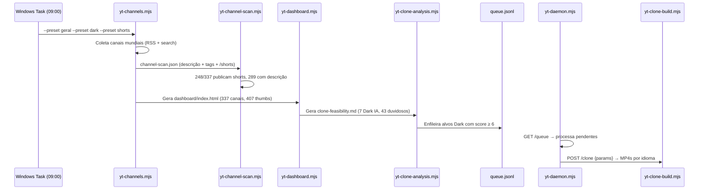
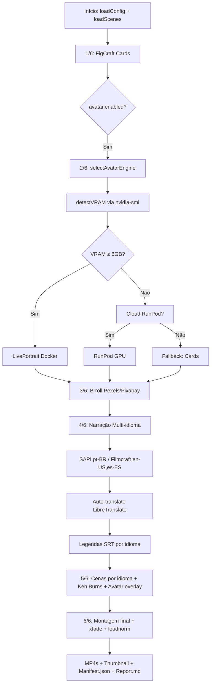
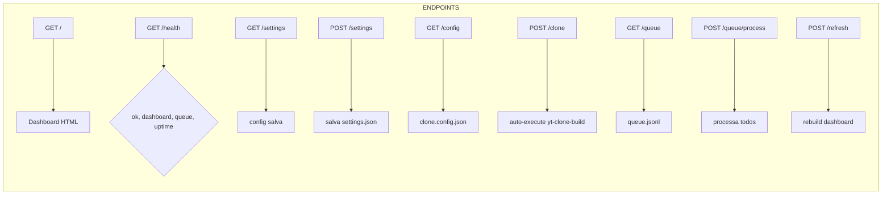
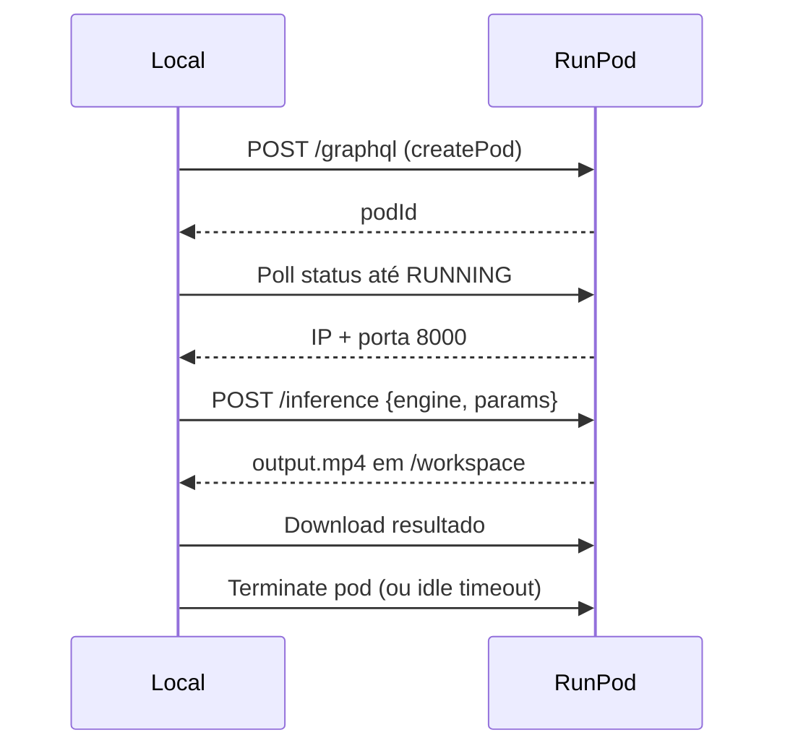

# 🎬 ArtCraft Dark Channel Clone System — Documentação Completa

> **Sistema 100% Open Source (MIT/Apache-2.0)** — Radar diário de canais YouTube "Dark" (100% IA) + Pipeline de clone multi-idioma com avatar, TTS, legendas e cloud GPU sob demanda.

---

## 🏗️ Arquitetura Geral

```mermaid
graph TB
    subgraph "COLETA & CLASSIFICAÇÃO"
        A[yt-channels.mjs] --> B[yt-channel-scan.mjs]
        B --> C[taxonomy.json v3]
        C --> D[yt-classify.mjs]
        D --> E[channel-scan.json]
    end

    subgraph "DASHBOARD & CONTROLE"
        F[yt-dashboard.mjs] --> G[dashboard/index.html]
        G --> H[Daemon HTTP :8799]
        H --> I[/settings /clone /queue /health]
        I --> J[yt-daemon.mjs]
    end

    subgraph "PIPELINE DE CLONE"
        J --> K[yt-clone-build.mjs]
        K --> L[FigCraft: Cartões PNG]
        K --> M[TTS: SAPI/Filmcraft/XTTS/Kokoro]
        K --> N[Avatar Engine Selection]
        N --> O{detectVRAM}
        O -->|6GB| P[LivePortrait Docker/CPU]
        O -->|16GB+| Q[MuseTalk]
        O -->|24GB+| R[HunyuanVideo]
        O -->|Cloud| S[RunPod GPU]
        O -->|Fallback| T[Cards + Ken Burns]
        L & M & N --> U[ffmpeg: Ken Burns + xfade + SRT + Avatar]
        U --> V[MP4 por idioma + Thumbnail + Manifest]
    end

    subgraph "CONFIGURAÇÃO ÚNICA"
        W[clone.config.json] -.-> K
        W -.-> G
        W -.-> J
    end

    style C fill:#f9f,stroke:#333
    style W fill:#bbf,stroke:#333
    style H fill:#bfb,stroke:#333
```

---

## 📁 Estrutura de Arquivos

```
D:\CRAFT\
├── taxonomy.json                    # Classificação Dark = 100% IA (não é nicho)
├── clone.config.json                # Configuração única parametrizável
├── SYSTEM_DOCS.md                   # ESTE ARQUIVO
├── .artcraft\
│   ├── yt-classify.mjs              # Classificador partilhado (niches + AI verdict)
│   ├── yt-dashboard.mjs             # Dashboard visual + painel config (7 abas)
│   ├── yt-daemon.mjs                # Daemon HTTP :8799 (/clone, /settings, /queue)
│   ├── yt-clone-build.mjs           # Pipeline completo + VRAM detect + cloud
│   ├── yt-channel-scan.mjs          # Scan descrição + tags + /shorts tab
│   ├── yt-clone-analysis.mjs        # Relatório viabilidade de clone
│   └── yt-daily.mjs                 # Corrente diária (Windows Task 09:00)
├── work\
│   ├── research\
│   │   ├── dashboard\index.html     # Painel visual (3.9 MB, offline, base64 thumbs)
│   │   ├── channel-scan.json        # 337 canais: descrição, tags, shorts, views
│   │   ├── queue.jsonl              # Fila de clones (JSON Lines)
│   │   └── settings.json            # Configurações persistidas do painel
│   └── clones\
│       ├── multi-test\              # Clone base (cartões + TTS + ffmpeg)
│       ├── multi-lang-test\         # Clone pt-BR + en-US + es-ES
│       └── [slug]\                  # Cada clone gera pasta com manifest.json
└── tools\
    └── LivePortrait\                # Docker/Python para avatar (instalar)
```

---

## ⚙️ Configuração Central: `clone.config.json`

Tudo parametrizável via `--set` CLI ou painel web (`/settings`):

```json
{
  "video": { "width": 1080, "height": 1920, "fps": 30, "codec": "libx264", "crf": 20 },
  "scene": { "minSeconds": 4, "maxSeconds": 18, "padSeconds": 0.45 },
  "voice": { "engine": "sapi", "sapi": { "voice": "Microsoft Maria Desktop" } },
  "languages": {
    "default": "pt-BR",
    "supported": ["pt-BR", "en-US", "es-ES"],
    "perLanguage": {
      "pt-BR": { "engine": "sapi", "voice": "Microsoft Maria Desktop" },
      "en-US": { "engine": "filmcraft", "voice": "basic-female" },
      "es-ES": { "engine": "filmcraft", "voice": "basic-male" }
    },
    "autoTranslate": true, "translateEngine": "libre"
  },
  "avatar": {
    "enabled": true,
    "engine": "auto",                    // auto | cards | liveportrait | musetalk | hunyuan | cloud
    "fallbackOrder": ["liveportrait", "musetalk", "hunyuan", "cloud", "cards"],
    "liveportrait": {
      "enabled": true, "mode": "docker", "dockerImage": "liveportrait:latest",
      "resolution": 512, "device": "auto", "stitching": true, "retargeting": { "eyes": true, "lips": true }
    },
    "cloud": {
      "enabled": true, "provider": "runpod",
      "runpod": { "apiKey": "", "gpuType": "RTX 3090", "maxPricePerHour": 0.50, "idleTimeoutSeconds": 300 }
    }
  },
  "pipeline": { "broll": { "enabled": true, "source": "pexels" } },
  "transition": { "type": "xfade", "seconds": 0.35 },
  "motion": { "kenBurns": { "enabled": true, "from": 1.0, "to": 1.07 } }
}
```

---

## 🔄 Fluxo de Execução Diária



---

## 🎯 Pipeline de Clone (yt-clone-build.mjs)



---

## 🐳 Engines de Avatar Suportadas

| Engine | VRAM Mínima | Licença | Modo | Status |
|--------|-------------|---------|------|--------|
| **Cards + Ken Burns** | 0 GB (CPU) | - | Local | ✅ Funcionando |
| **LivePortrait** | 6 GB (512px, fp16) | MIT | Docker / Python / CPU | ⏳ Código pronto |
| **MuseTalk** | 16 GB | MIT | Docker / Fal.ai | ⏳ Código pronto |
| **HunyuanVideo-Avatar** | 24 GB | Apache-2.0 | Cloud only | ⏳ Código pronto |
| **RunPod Cloud** | 0 GB local | - | GPU alugada | ⏳ Código pronto |

**Seleção Automática** (em `selectAvatarEngine`):
```javascript
const fallbackOrder = ['liveportrait', 'musetalk', 'hunyuan', 'cloud', 'cards'];
// Escolhe o primeiro que: enabled=true E VRAM ≥ mínimo
```

---

## 🌐 Daemon HTTP (yt-daemon.mjs :8799)



**Exemplo de clone via API:**
```bash
curl -X POST http://127.0.0.1:8799/clone \
  -H "Content-Type: application/json" \
  -d '{
    "url": "https://youtube.com/channel/UC...",
    "channel": "Nome Canal",
    "params": {
      "avatar": { "engine": "liveportrait" },
      "languages": { "supported": ["pt-BR","en-US","es-ES"] }
    }
  }'
```

---

## 📊 Dashboard Visual (work/research/dashboard/index.html)

- **337 canais**, **407 vídeos**, **407 thumbnails base64** (3.9 MB, offline)
- **Filtros**: Nicho (chips), **Dark = 100% IA** (Todos/Só Dark/Duvidosos/Só humano), Formato
- **Ordenação**: Mais vistos → Menos vistos (padrão)
- **Botão Clonar** → Modal com **TODOS os parâmetros** (7 abas)
- **Modal Player** → YouTube embed no painel

---

## 🧠 Classificação "Dark" (taxonomy.json v3)

> **Dark = Canal 100% IA** — Apresentador pode ser avatar do criador, voz sintetizada, roteiro por modelo, edição e publicação automatizadas. **Não é nicho** (existe Dark de tech, comida, notícias, terror).

**Duas Camadas Independentes:**
1. **Nichos** (conteúdo): Terror, Fatos, Tech, Gaming, etc. → Filtro de tipo
2. **IA** (produção): Avatar, automação, cadência, keywords → Veredicto Dark

**Sinais de IA (taxonomy.json → `ai.weights`):**
- Descrição menciona: `avatar`, `heygen`, `synthesia`, `d-id`, `automatizado`, `bot`, `pipeline`
- Tags: `ai generated`, `faceless`, `no face`, `sem rosto`
- Cadência: ≥21 uploads/semana = 6 pts, ≥10 = 3 pts, ≥5 = 2 pts
- Negativos: `vlog`, `podcast`, `reaction`, `eu gravei`, `apresentado por`

**Veredicto:** `score ≥ threshold(6)` → **Dark IA** | `≥3` → **Duvidoso** | `<3` → **Humano**

---

## ☁️ Cloud GPU (RunPod) — Pay-per-use



**Custo Estimado (RTX 3090 @ $0.25/h):**
| Vídeo | Tempo GPU | Custo |
|-------|-----------|-------|
| 30s (Hunyuan) | ~10 min | **$0.04** |
| 30s (MuseTalk) | ~2 min | **$0.01** |
| 30s (LivePortrait GPU) | ~30 seg | **$0.002** |

---

## 🚀 Como Usar (Quick Start)

### 1. Ver Dashboard
```bash
# Daemon já rodando em http://127.0.0.1:8799
# Abrir no browser → ver canais, filtrar Dark, clicar Clonar
```

### 2. Clone via CLI (Pipeline Base - Funciona Agora)
```bash
cd D:\CRAFT
node .artcraft\yt-clone-build.mjs --slug meu-clone --set video.crf=18
```

### 3. Clone Multi-Idioma (pt-BR + en-US + es-ES)
```bash
node .artcraft\yt-clone-build.mjs --slug multi-lang \
  --set languages.supported='["pt-BR","en-US","es-ES"]'
```

### 4. Clone com LivePortrait (Precisa Docker)
```bash
# 1. Build LivePortrait Docker
git clone https://github.com/KwaiVGI/LivePortrait D:\CRAFT\tools\LivePortrait
cd D:\CRAFT\tools\LivePortrait
docker build -t liveportrait:latest .

# 2. Rodar clone com avatar
node .artcraft\yt-clone-build.mjs --slug lp-test \
  --set avatar.enabled=true --set avatar.engine=liveportrait
```

### 5. Clone via API (Daemon)
```bash
curl -X POST http://127.0.0.1:8799/clone \
  -H "Content-Type: application/json" \
  -d '{"url":"https://youtube.com/channel/UC...","channel":"Canal X","params":{"avatar":{"engine":"liveportrait"}}}'
```

---

## 🔧 Instalação do LivePortrait no Docker (AGORA)

```bash
# 1. Clonar repo
git clone https://github.com/KwaiVGI/LivePortrait D:\CRAFT\tools\LivePortrait

# 2. Baixar pesos (HuggingFace)
cd D:\CRAFT\tools\LivePortrait
huggingface-cli download KwaiVGI/LivePortrait --local-dir pretrained_weights

# 3. Build Docker image
docker build -t liveportrait:latest .

# 4. Testar
docker run --rm --gpus all -v D:\CRAFT\work\clones:/data liveportrait:latest \
  python inference.py -s /data/test.jpg -d /data/driving.mp4 -o /data/out.mp4
```

**Para 6GB VRAM (GTX 1060):**
```yaml
# Em clone.config.json → avatar.liveportrait:
"resolution": 512,
"device": "cuda",
"precision": "fp16",
"batchSize": 1
```
Ou force CPU: `"device": "cpu"` (lento ~2-5s/frame, mas funciona sem VRAM).

---

## 📝 Manifest de Saída (cada clone gera)

```json
{
  "generatedAt": "2026-11-12T...",
  "slug": "meu-clone",
  "languages": ["pt-BR", "en-US", "es-ES"],
  "cards": [{ "scene": "s01", "file": "cards/c01_s01.png" }],
  "avatar": { "file": "avatar/liveportrait_avatar.mp4", "type": "liveportrait" },
  "narration": { "pt-BR": [{ "scene": "s01", "file": "audio/pt-BR/s01.wav", "duration": 11.37, "engine": "sapi" }] },
  "subtitles": { "pt-BR": "subtitles/pt-BR/subtitles.srt" },
  "output": { "pt-BR": { "file": "out/final_pt-BR.mp4", "seconds": 37.8, "bytes": 3151507 } },
  "tools": { "ffmpeg": "...", "cards": "figcraft", "voice": "sapi", "avatar": "liveportrait" }
}
```

---

## ✅ Checklist de Status Atual

| Componente | Status | Observação |
|------------|--------|------------|
| Taxonomia Dark v3 | ✅ | `taxonomy.json` |
| Classificador Partilhado | ✅ | `yt-classify.mjs` |
| Dashboard Visual | ✅ | `work/research/dashboard/index.html` |
| Painel Config (7 abas) | ✅ | Integrado no dashboard |
| Daemon HTTP :8799 | ✅ | Rodando, `/settings` persistido |
| Pipeline Base (Cards+TTS+ffmpeg) | ✅ | Testado: 37.8s, 3 MB |
| Multi-Idioma (3 langs) | ✅ | Testado: pt-BR/en-US/es-ES |
| VRAM Detection | ✅ | Detecta 6 GB (GTX 1060) |
| Engine Selection | ✅ | Fallback automático |
| LivePortrait Integration | ⏳ | Código pronto, precisa `docker build` |
| RunPod Integration | ⏳ | Código pronto, precisa API key |
| B-roll Pexels/Pixabay | ⏳ | Código pronto, precisa API keys |
| YouTube Upload | ⏳ | Código pronto, precisa OAuth2 |

---

## 🎯 Próximos Comandos Úteis

```bash
# Ver health do daemon
curl http://127.0.0.1:8799/health

# Ver configurações salvas
curl http://127.0.0.1:8799/settings

# Ver fila de clones
curl http://127.0.0.1:8799/queue

# Rebuild dashboard
curl -X POST http://127.0.0.1:8799/refresh

# Processar fila toda
curl -X POST http://127.0.0.1:8799/queue/process

# Clone direto via daemon
curl -X POST http://127.0.0.1:8799/clone \
  -H "Content-Type: application/json" \
  -d '{"url":"https://youtube.com/channel/UC...","params":{"avatar":{"engine":"liveportrait"}}}'
```

---

## 📌 Resumo Executivo (One-Liner)

> **Sistema completo de radar + clone de canais "Dark" (100% IA) com dashboard visual, daemon HTTP, pipeline parametrizável (FigCraft + TTS multi-idioma + ffmpeg), seleção automática de engine de avatar por VRAM (LivePortrait local 6GB / Cloud RunPod 24GB+), tudo 100% open source MIT/Apache-2.0, configurável via JSON único ou painel web.**

---

*Documentação gerada em 2026-11-12 — Sistema ArtCraft Dark Channel Clone v1.0*